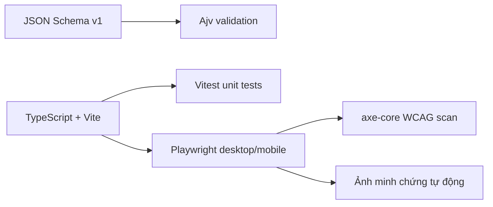

# Quyết định áp dụng công cụ chất lượng cao — TV4

**Cập nhật:** 11/10/2026
**Phạm vi:** cải thiện validation và kiểm thử mà không đổi kiến trúc TypeScript/Vite hoặc UI hiện tại.

## Công cụ được áp dụng

| Nhóm | Công cụ | Vai trò | Phần được thay thế/bổ sung |
|---|---|---|---|
| Schema validation | Ajv | Compile JSON Schema draft 2020-12 | Thay validator preset viết tay; giữ thông báo UI tiếng Việt |
| Unit test | Vitest | Test runner tích hợp với Vite/TypeScript | Thay Node test runner; giữ nguyên 17 case hành vi |
| Browser/E2E | Playwright | Kiểm thử Chromium ở viewport desktop/mobile | Tự động hóa interaction, fixture runtime, import/export và overflow |
| Accessibility | axe-core qua Playwright | Quét WCAG A/AA có thể tự động phát hiện | Bổ sung kiểm tra; không thay kiểm tra bàn phím/thị giác thủ công |
| Sơ đồ tài liệu | Mermaid trên GitHub Markdown | Giữ quyết định và luồng kiểm thử dễ đọc | Dùng khả năng render sẵn có, không thêm dependency runtime |

## Quy tắc kiến trúc

- `docs/02-design/preset-schema-v1.schema.json` tiếp tục là nguồn chuẩn cho preset v1.
- Không đưa React, Tailwind, shadcn/ui, Storybook, XState hoặc Three.js vào thay đổi này.
- Playwright chỉ kiểm thử UI fixture; không chứng minh WebGPU/WebGL2 hoặc benchmark thật.
- Kiểm tra accessibility tự động không thay thế đánh giá keyboard, screen reader và chất lượng thị giác của con người.
- Ảnh cũ được giữ làm lịch sử; ảnh tên `automated-*` được tạo lại bằng `npm run evidence:screenshots`.

## Tiêu chí hoàn thành

1. Typecheck và production build đạt.
2. Toàn bộ unit test chạy bằng Vitest và đạt.
3. E2E desktop/mobile đạt trên Chromium.
4. axe-core không báo lỗi WCAG A/AA trong trạng thái mặc định.
5. Bốn ảnh minh chứng tự động được lưu đúng thư mục testing.

## Công cụ hoãn lại

- Storybook: xem xét khi UI có nhiều component tái sử dụng độc lập.
- Three.js/XState: chờ TV1/TV2/TV3 chốt engine và lifecycle.
- Docusaurus/Plane: chưa đủ quy mô để bù chi phí thiết lập và vận hành.
