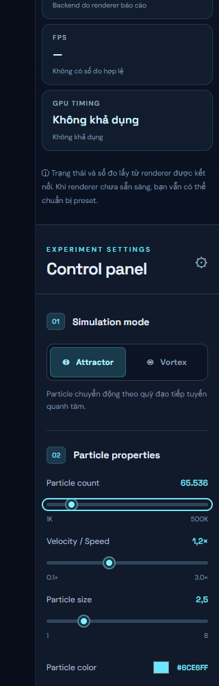
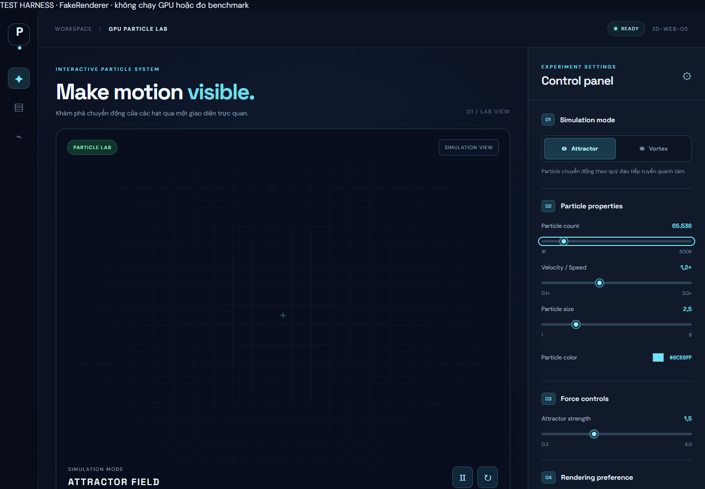

# Issue #101 — keyboard focus on ranges

Baseline: `dev@3d1c4f64871dcc1d1d93c5a4ed99c1f54fe6dcc0`.
Independent branch: `fix/101-range-focus`; TV4, reviewer TV5 `DangTAnh`.
Final commit/CI are recorded in the associated Draft PR.

## Cause and minimal fix

The scoped `.panel-scroll input[type=range]` reset wins over generic input
focus rules. A keyboard-focused range matches `:focus-visible` but has no
outline. One scoped range `:focus-visible` rule in tokens.css restores the
existing `--ui-focus` token with 5px offset. It surrounds the 5px track and
15px thumb without changing range dimensions or bindings. Pointer interaction
keeps the range reset; no global focus rule is changed.

No markup, slider min/max/step, precision, disabled semantics, LabConfig,
RendererPort, schema/hash, renderer, GPU timing or kernel change. This branch
contains neither #98 nor #102 and excludes #103/bulk UI/release work.

## Reproduction and tests

`tests/e2e/range-focus.spec.ts` reaches every range using real keyboard Tab.
For 1440/320/390/500px in both desktop and mobile-emulated projects it verifies:

- Focus ownership, `:focus-visible`, solid 2px accent outline vs dark background.
- Complete outline geometry inside viewport and each clipping/scroll ancestor.
- Different focused/blurred viewport screenshot buffers; blur has no outline.
- Mouse click does not request keyboard focus styling.
- Home, ArrowRight/Left, End and Vietnamese output label values.
- Unchanged min/max/step, full exported config vs renderer apply calls.
- All four ranges remain disabled when renderer becomes unavailable.

The test includes focused/blurred screenshot attachments for desktop1440 and
narrow320; the final focused images are retained beside this document. These
are real browser DOM/CSS/keyboard tests using a fake RendererPort. They do not
establish GPU execution or physical-phone acceptance.

Before CSS patch: desktop1440 test FAIL, expected outline solid / actual none.
First post-patch attempt: 7 PASS /1 FAIL because a viewport-coordinate crop
captured the wrong area after mobile scrolling. A document-coordinate crop
attempt: 36 PASS /6 FAIL across the mixed 42-case run; all six failures were
out-of-image screenshot crops. That run's existing UI tests passed all 34
cases, including two @evidence cases. Their four generated historical image
replacements were restored from this clean branch's baseline, not committed.
Section screenshots then passed 8/8, but visual QA found their crop excluded
the outer outline margin. Final evidence captures the full viewport instead.
Failed reports are preserved outside Git in the task output directory.

## Environment and commands

Node22.16.0/npm11.10.1, TS5.9.3/Playwright1.64.0/Three0.186.1, unchanged lockfile.
Both typechecks PASS; `npm test`: 336 PASS /30 files; build PASS (existing
large-chunk advisory). Browser runs use installed Chrome157.0.8103.51 via a
temporary copy of standard Playwright config: project channel=chrome,
video=off, original projects/workers/assertions retained. Bundled Chromium
download timed out during #98; standard local bundled-browser run NOT_RUN.

```sh
npx playwright test tests/e2e/range-focus.spec.ts --retries=0
npx playwright test tests/e2e/ui.spec.ts tests/e2e/ui-port.spec.ts --grep-invert '@evidence' --retries=0
npm run typecheck
npm run typecheck:tests
npm test
npm run build
git diff --check
```

For the recorded local browser results, add
`--config playwright.chrome.local.ts` with the temporary override described
above. CI uses the unchanged committed Playwright config. No human approval,
release/deployment or physical-device result is claimed.

Final viewport-screenshot regression: **8 PASS /0 FAIL /0 SKIP**, 43.9s,
retries=0; final source/test typechecks, build and diff check PASS. The two
focused viewport images were visually inspected: the complete cyan outline is
visible with panel padding on desktop1440 and narrow320. The other widths and
all four sliders pass the geometry and screenshot-change assertions.



