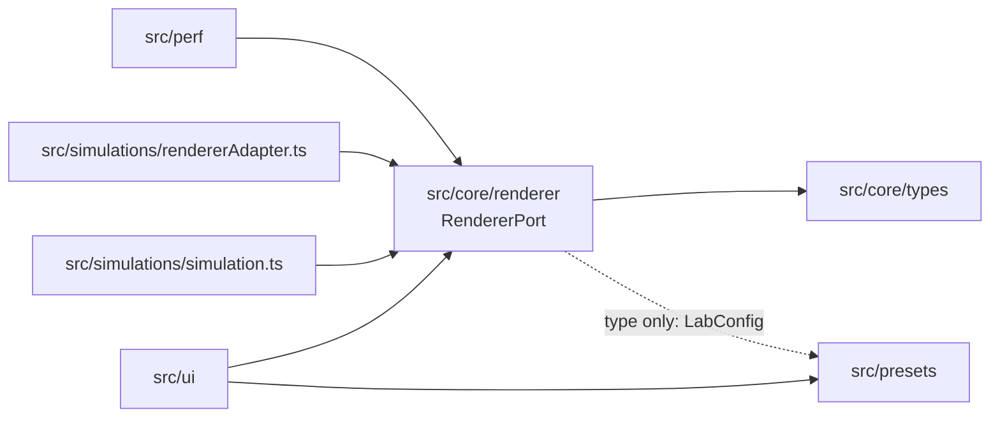

# Architecture — 3D-WEB-05 GPU Particle Lab

Owner: TV1 (`src/core/`, `src/main.ts`, `.github/`).
Status: **partially implemented**. This file records what exists today, what the
target shape is, and the rules that keep the two from drifting apart.

Historical PR #62 integration baseline (28/10/2026): `dev@db82315` includes Issue #52
runtime recovery and PR #69 CI hardening. The merged recovery policy and the
Issue #53 GPU-age proposal below coexist; hardware WebGPU recovery/timestamp
freshness remains **NOT_RUN**. TV1/TV5 acceptance was pending at that checkpoint.
Current baseline: PR #62 merged at `dev@1427691` on 29/10/2026; Issue #53 is
closed. PR #76 integrates that contract; its own current-head owner reviews
and independent human approval remain required.

Related documents: [`ui-requirements.md`](01-requirements/ui-requirements.md),
[`mvp-acceptance.md`](01-requirements/mvp-acceptance.md),
[`ui-interaction-spec.md`](02-design/ui-interaction-spec.md),
[`team-ownership.md`](05-management/team-ownership.md).

---

## 1. What exists today

| Area | State | Location |
|---|---|---|
| Renderer contract | Typed port implemented by ThreeRendererAdapter; UI consumes the injected port | [`src/core/renderer/RendererPort.ts`](../src/core/renderer/RendererPort.ts) |
| Backend identity types | Implemented (types only) | [`src/core/types/backend.ts`](../src/core/types/backend.ts) |
| Perf sample shape (`PerformanceSnapshot`) | Implemented (type only) | [`src/core/types/measurement.ts`](../src/core/types/measurement.ts) |
| Benchmark config identity (`configHash`) | Implemented | [`src/core/measurement/configHash.ts`](../src/core/measurement/configHash.ts) |
| Preset domain (parse/serialize) | Implemented, client-side only | [`src/presets/preset.ts`](../src/presets/preset.ts) |
| UI shell | Consumes an injected RendererPort; no backend init in UI | [`src/ui/app.ts`](../src/ui/app.ts) |
| Simulation preview | Production canvas bound to the real adapter by the composition root; Canvas2D mock removed | `src/main.ts` |
| Renderer adapter (one, backend-flagged) | #12 and #13 source merged through #39/#40; Issue #52 adds one runtime WebGPU-to-WebGL2 recovery attempt; real GPU loss acceptance remains pending | `src/simulations/rendererAdapter.ts` |
| Composition root | Implemented; initializes the adapter before mounting the port-consuming UI | [`src/main.ts`](../src/main.ts), [`src/composition.ts`](../src/composition.ts) |
| Simulation: CPU reference + shared TSL buffers/kernels | Source merged in #21/#35; WebGL2 readback parity passed (#50, SwiftShader), WebGPU adapter NOT_RUN | `src/simulations/simulation.ts`, `src/simulations/shared/` |
| Perf collector | RendererPort frame sampler implemented; warm-up and cadence are configured by caller | [`src/perf/collector.ts`](../src/perf/collector.ts) |
| Server, auth, persistence | **Out of scope for this repo** | — |

There is **one** renderer, not one per backend. Backend choice and fallback are
implemented by `ThreeRendererAdapter` together with `startBackend()` in
`src/simulations/backend/fallback.ts`: `auto` and `webgpu` attempt WebGPU first,
then try WebGL2 only when initialization reports `BackendUnavailableError`;
`webgl2` goes directly to that backend. The adapter's WebGPU API/WebGL2-context
checks are part of initialization, not a prediction-only probe. Programming
errors propagate. The adapter reports `actual` from the renderer that
successfully initialized. The separate `capabilities.ts` probe/resolver was
removed because it duplicated this decision and could not establish that a
renderer would initialize. Backend-specific modules must not copy simulation
rules.

Without an injected port the default build reports unavailable and keeps preset
import/export available. FakeRenderer is used only by the explicit E2E harness;
its labels/measurements are test inputs, never WebGPU/WebGL2 benchmark evidence.

## 2. Dependency rules



Solid arrows are runtime dependencies; the dotted arrow is type-only. Arrows
never point back toward `src/ui`.

Rules:

1. `src/core/types/` imports nothing. It is the leaf.
2. `src/core/renderer/` may import types only. No DOM, no `three`, no network.
3. `src/simulations/*` may import `src/core/`; **never** the reverse.
4. `src/ui/` may not import `src/simulations/*` directly — only `RendererPort`.
5. `src/presets/` may not import `src/ui/`.

Rule 4 is exercised by the UI port consumer and the fake-port interaction tests.
The production adapter and composition-root injection implement this boundary;
see [UI port handoff](04-testing/UI-renderer-port-2026-10-24.md) for lifecycle,
default config application and the no-port compatibility path.

## 3. Backend boundary

`BackendPreference` (`auto | webgpu | webgl2`) is a request. `ActualBackend`
(`webgpu | webgl2 | unavailable`) is a fact produced by the engine.

**INV-1 — measurement integrity.** A benchmark row must record the backend that
actually ran, and `gpuTimeMs` is `null` if and only if `gpuTimingAvailable` is
false. Recording the requested backend, or writing `0` for "not measured",
invalidates every comparison the project is built to produce.

`RendererStatus` encodes this directly: `requested` exists only to explain a
fallback, and `actual` is the only backend identity a benchmark row may store.

`measurementAgeMs` describes only the age of the latest valid GPU timing
sample, measured from compute submission with a monotonic clock. Its age
therefore includes asynchronous timestamp-readback delay. A sample is fresh for
at most `MAX_GPU_MEASUREMENT_AGE_MS` (2 seconds); the adapter requests one query
per 10 compute frames (nominally supports 5 FPS before readback latency), and
slower frames or delayed queries may still make it stale. Stale timing is
reported unavailable with a null value. Pause, reset and renderer/backend
reinitialization clear timing and age. The collector skips paused samples; when
only GPU timing is stale, it preserves valid FPS and records GPU timing as
unavailable/null. This field does not establish FPS freshness; that remains the
separate Issue #55 contract. The field and threshold are the Issue #53
contract merged through PR #62.

**Runtime device/context loss policy (Issue #52).** If the active WebGPU device
is lost after initialization, the adapter disposes it, replaces the canvas in
the same stable host, and attempts WebGL2 once. A canvas cannot change its
context mode after `getContext('webgpu')`, so recovery must use a fresh canvas.
The adapter and `RendererSession` preserve the latest start/pause intent while
asynchronous recovery runs, including a Play request received by the session
while the active adapter reports unavailable. If WebGL2 is already active or
the recovery renderer is lost, it reports `actual: unavailable` and stops; it
does not loop or add a CPU path. The UI
measures the stable host, so resize handling remains bound across canvas
replacement. The shared canvas factory re-resolves the connected preview canvas
before a later user-requested backend switch, so adapter-owned replacement does
not leave composition pointing at a detached canvas. Adapter tests simulate
context-mode locking and delayed recovery; Chromium tests cover WebGL2 context
loss. Physical GPU device-loss behavior is not verified in the current
environment.

## 4. Renderer contract

`RendererPort` (see the file for full doc comments):

```ts
init(target: RendererTarget): Promise<ActualBackend>
applyConfig(config: Readonly<LabConfig>): void
start() / pause() / reset()
getStatus(): RendererStatus
dispose(): void
```

Design notes:

- `init` **resolves** with `unavailable` instead of throwing, because "no GPU
  backend" is a normal state the UI must render, not an exception.
- `applyConfig` is called on every slider tick; it must not allocate GPU
  resources or start a request. Only an explicit preset save reaches a server.
- The contract is transport-free and DOM-free so that `tests/unit/renderer-port.test.ts`
  can exercise callers with a fake — no canvas, no GPU.
- **`backendPreference` is read at `init()`.** Changing it later through import
  or reset does not switch a running renderer; the next `init()` applies it.
  This is a decision by TV1 on 2026-10-22, not an open question: UC-03
  (`01-requirements/use-cases.md`) describes choosing a backend and then
  initialising it, and `UI-FR-04` requires displaying the backend that actually
  ran. Neither requires hot-swapping. The former D-08 is resolved by this rule.

When a real backend is added, `ThreeRendererAdapter` will be **one** class with a
backend flag (`forceWebGL`), not two classes: `three/webgpu` selects the backend
at construction and exposes `renderer.backend.isWebGPUBackend`. Two classes
would duplicate the same TSL material tree.

### 4.1 Who owns each contract

Issue #54 adds an explicit next-init action through `RendererSession` in the
composition layer. The session implements the unchanged `RendererPort` and
replaces concrete adapters transactionally. The shared composition canvas factory
stages a deep-cloned canvas in an inert, hidden host because a canvas cannot change
its context type. The live renderer remains available until the candidate is ready;
failed initialization discards only the candidate. At commit the old simulation
pauses before the replacement starts, then the old port/surface are disposed.
Initialization may temporarily own two renderer resources; superseded candidates
are disposed and cannot commit. The factory preserves fallback canvas content
and resolves the connected preview canvas before staging, so a canvas replaced by
Issue #52 runtime recovery remains the starting surface for the next Apply.
UI remains mounted
once (one poller, control binding and ResizeObserver of the stable host), and
receives only a re-init callback and loading predicate. Generation checks prevent
late init completion from publishing an obsolete backend. User config and running
intent survive re-init; initial unavailable cannot create running intent. The
application callback returns applied/failed/superseded plus requested/actual and
rollback information so UI can report failure even when initialization resolves.
Metrics come only from the current ready adapter. PR #62 is merged into
`dev@1427691`; this branch integrates its required GPU-only measurement age
contract. Pending/unavailable sessions report `measurementAgeMs: null` and
unavailable/null GPU timing; valid FPS is retained when only GPU timing expires.
Independent FPS freshness remains Issue #55.
This
composition/lifecycle change requires TV1/TV3 review before merge.

| Contract | Defined in | Producer | Consumers | Owner |
|---|---|---|---|---|
| `RendererPort`, `RendererStatus` | `src/core/renderer/RendererPort.ts` | TV1 | UI, perf, both renderers | TV1 |
| `ActualBackend`, `BackendPreference` | `src/core/types/backend.ts` | TV1 | renderer, perf, UI | TV1 |
| `LabConfig`, preset JSON v2 | `src/presets/preset.ts` | TV4 | UI, renderer, future server | TV4 |
| `PerformanceSnapshot`, `configHash` | `src/core/types/measurement.ts`, `src/core/measurement/configHash.ts` | TV1 | TV5, ingestion | TV1 |

A contract changes only with its owner's review. Consumers adapt; the contract
does not bend per consumer.

Who writes which file is in [`05-management/team-ownership.md`](05-management/team-ownership.md);
this table is about contracts, not about people.

## 5. Data ownership

| Data | Owner | Rule |
|---|---|---|
| Preset JSON (v2) | Preset module | `schemaVersion: 2`, nested config, optional name; v1 and unknown keys rejected |
| Backend identity | Renderer port | Only the engine may produce `ActualBackend` |
| Performance samples | Perf collector | Must carry `actual`, never the requested backend; unavailable GPU timing is `null` |

There is no persistence layer in this repository yet. Any claim about stored
data in the current codebase would be false.

### 5.1 Benchmark configuration identity (`configHash`)

`configHash` is **active workload identity**, per [TV1 decision on Issue #16](https://github.com/DangTAnh/SE2026.11.1.3D-WEB-05/issues/16#issuecomment-6438150192).
It is not full preset identity. A benchmark must retain the full validated
nested `config` beside the hash (`BenchmarkResult.config`); compare rendering
and camera settings before treating two runs as fair comparisons.

Decision reaffirmed by [TV1 review 29/10/2026](https://github.com/DangTAnh/SE2026.11.1.3D-WEB-05/pull/76#discussion_r4411879288): retain this projection (option A).
It does **not** identify total GPU rendering cost. For example, changing only
`rendering.additiveBlend` or `rendering.opacity` (including a transparent-state
transition) keeps the same hash although material/GPU state and cost can change.
Camera changes can similarly alter visible work. These are intentional identity
collisions, not evidence of equivalent benchmark conditions.

`collectBenchmarkSamples` pins a validated full config and rejects any config
change observed during sampling, including excluded rendering/camera fields.
`buildBenchmarkResult` retains an isolated validated config snapshot. Its raw
sample input contains only hashes: it cannot reconstruct missing full-config
provenance or detect previously mixed same-hash samples. Callers must collect
under the pinned full preset and must never concatenate independent datasets
solely by `(configHash, actual)`. Compare the full validated preset, environment
and protocol before combining runs; backend preference may differ deliberately
when selecting backends, but actual backend is always recorded separately.

| Canonical field | Source | Attractor | Vortex |
|---|---|---|---|
| mode | config.mode | included | included |
| particleCount, spawnRadius, particleSize, lifetime, speed | simulation.* | included | included |
| attractorStrength, attractorRadius, attractorDamping | modes.attractor.* | included | excluded |
| vortexStrength, vortexDamping | modes.vortex.* | excluded | included |
| backendPreference | config.backendPreference | excluded: request; actual recorded separately | excluded |
| rendering.*, camera.* | appearance/view | excluded; full config required | excluded |
| name, schemaVersion, app | preset envelope | excluded | excluded |

Canonical JSON is **flat**, alphabetical keys, no whitespace, finite numbers
rounded to 3 decimal places with no trailing zeros. SHA-256 over UTF-8 gives
64 lowercase hexadecimal characters. Exact default vectors:

```json
{"attractorDamping":0.98,"attractorRadius":6,"attractorStrength":1.5,"lifetime":6,"mode":"attractor","particleCount":65536,"particleSize":2.5,"spawnRadius":10,"speed":1.2}
{"lifetime":6,"mode":"vortex","particleCount":65536,"particleSize":2.5,"spawnRadius":10,"speed":1.2,"vortexDamping":0.99,"vortexStrength":1.5}
```

Expected hashes, respectively:
`0f917cd0a56e3d7b63f53c7f1e7bb5f2cdfb70d6191454733baf204f0fc907fa`
and `1d178f4522821a47f7c165efa4cf95aeb3171bf943f9fa511f22db7140669033`.
`canonicalConfig` rejects missing/nonfinite included values; range/precision and
unknown-key validation belong to the preset boundary. Runtime imports use v2
schema only, require all groups (including inactive mode), accept integer counts
1000..500000 without a 1000-step constraint, and enforce numeric precision 0.001.

### 5.2 Preset document and runtime consumers

`PresetDocument` retains optional name outside `LabConfig`. UI edits, mode switch,
backend Apply and simulation reset retain name; restore defaults or importing an
unnamed document clears it. Failed validation/apply retains prior config/name.
If apply succeeds but simulation reset fails, the new config/name stay together.
Serialization fixes ordering at every level, indent 2, final LF newline.

All runtime groups are consumed by the shared adapter: simulation count rebuilds
storage, size updates material, speed multiplies clamped delta once, spawn/lifetime
feed init/respawn uniforms. Only the active mode parameters reach its kernel.
Rendering updates color/background/opacity/blending; transparency/blending changes
mark material for recompilation. OrbitControls owns camera enabled/autoRotate and
distance around the existing target. Distance/zoom is bounded 5..500; far plane
reserves the maximum orbit range plus twice the spawn/active radius extent.
Controls update per frame and are disposed on teardown/recovery. Captured root
keyboard listeners are additionally removed for Three r186.1 when session commit
detaches the old canvas before disposal. No simulation formula, new #56 controls
or #55 freshness semantics are introduced.

These cross-owner implementation changes require TV1/TV2/TV3 review, with TV5
reviewing benchmark reproducibility and tests; agent review is supplemental.

## 6. Known debt

| ID | Debt | Where |
|---|---|---|
| D-02 | Domain module touches the DOM (`downloadPreset`) | `src/presets/preset.ts` |
| D-03 | Unchecked cast from a DOM value into `LabConfig` | `src/ui/controls/controlBindings.ts` |
| D-05 | `serializePreset` re-parses its own output to self-validate | `src/presets/preset.ts` |
| D-06 | `RendererPort` depends on `src/presets` for the `LabConfig` type | `src/core/renderer/RendererPort.ts` |
| D-07 | UI injection API is available; TV1 supplies the initialized port from main. Live-status source merged in #33; remaining acceptance is tracked in #14 | `src/main.ts`, `src/ui/overlays/statusOverlay.ts` |

D-06 disappears once the config types move into `src/core/types/`; that change
needs TV4's agreement because `src/presets/` is theirs.

D-01 was resolved by the adapter and composition-root work in #12/#15.

D-04 was resolved by #33: the UI now renders `backendLabel` from
`RendererStatus.actual` in `src/ui/state/runtimeState.ts`, and no Canvas 2D or
mockup label remains. The ID is not reused.

D-08 is retired: a changed `backendPreference` applies on the next `init()`
(§4). The ID is not reused.

Open decisions that are not debt yet — the WebGL2 stepping path and the
`LabConfig` freeze date — are tracked in
[`05-management/team-ownership.md`](05-management/team-ownership.md) §7.
Evidence on the WebGL2 path is in
[`03-research/webgl2-simulation-options.md`](03-research/webgl2-simulation-options.md).

## 7. Verification

```bash
npm ci
npm run typecheck     # tsc --noEmit over src/
npm test              # Vitest unit and contract tests
npm run verify        # source/tests typecheck, unit, Chromium E2E, production build
```

`RendererPort` itself adds no runtime code; the contract test exists so that a
future implementation cannot quietly change what `actual` or `gpuTimeMs` mean.
