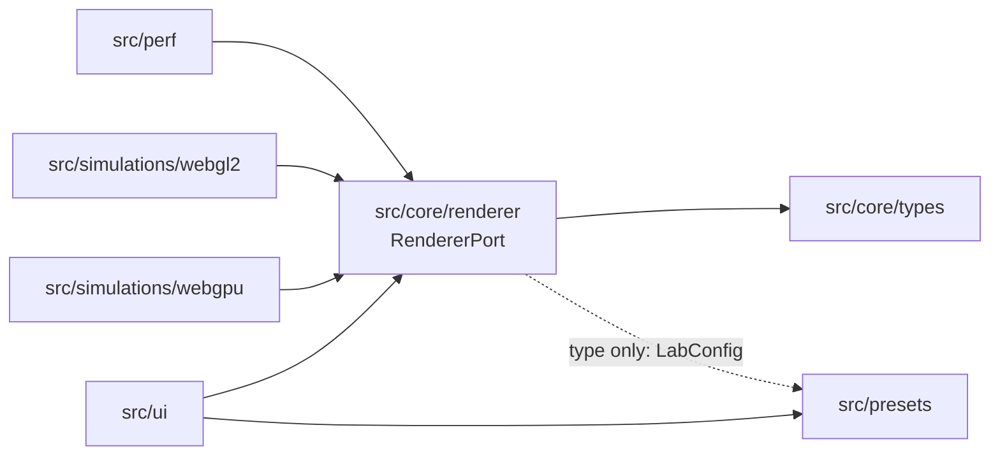

# Architecture — 3D-WEB-05 GPU Particle Lab

Owner: TV1 (`src/core/`, `src/main.ts`, `.github/`).
Status: **partially implemented**. This file records what exists today, what the
target shape is, and the rules that keep the two from drifting apart.

Related documents: [`ui-requirements.md`](01-requirements/ui-requirements.md),
[`ui-interaction-spec.md`](02-design/ui-interaction-spec.md),
[`team-ownership.md`](05-management/team-ownership.md).

---

## 1. What exists today

| Area | State | Location |
|---|---|---|
| Renderer contract | **Holds a written type, no implementation yet** | [`src/core/renderer/RendererPort.ts`](../src/core/renderer/RendererPort.ts) |
| Backend identity types | Implemented (types only) | [`src/core/types/backend.ts`](../src/core/types/backend.ts) |
| Preset domain (parse/serialize) | Implemented, client-side only | [`src/presets/preset.ts`](../src/presets/preset.ts) |
| UI shell | Implemented (prototype) | [`src/ui/app.ts`](../src/ui/app.ts) |
| Simulation preview | Canvas 2D mock, **not a GPU renderer** | [`src/ui/mock/particlePreview.ts`](../src/ui/mock/particlePreview.ts) |
| WebGPU renderer | Not started (TV2) | `src/simulations/webgpu/` |
| WebGL2 renderer | Not started (TV3) | `src/simulations/webgl2/` |
| Perf collector | Not started (TV5) | `src/perf/` |
| Server, auth, persistence | **Out of scope for this repo** | — |

The mock draws at most 600 points while the default config asks for 20,000, so
no timing produced by it is usable for a WebGPU/WebGL2 comparison.

## 2. Dependency rules



Solid arrows are runtime dependencies; the dotted arrow is type-only. Arrows
never point back toward `src/ui`.

Rules:

1. `src/core/types/` imports nothing. It is the leaf.
2. `src/core/renderer/` may import types only. No DOM, no `three`, no network.
3. `src/simulations/*` may import `src/core/`; **never** the reverse.
4. `src/ui/` may not import `src/simulations/*` directly — only `RendererPort`.
5. `src/presets/` may not import `src/ui/`.

Rule 4 is the one that currently does not hold: the UI imports the Canvas 2D
mock directly. Splitting `RendererPort` out is the first step; wiring the mock
behind it is tracked as D-01.

## 3. Backend boundary

`BackendPreference` (`auto | webgpu | webgl2`) is a request. `ActualBackend`
(`webgpu | webgl2 | unavailable`) is a fact produced by the engine.

**INV-1 — measurement integrity.** A benchmark row must record the backend that
actually ran, and `gpuTimeMs` is `null` if and only if `gpuTimingAvailable` is
false. Recording the requested backend, or writing `0` for "not measured",
invalidates every comparison the project is built to produce.

`RendererStatus` encodes this directly: `requested` exists only to explain a
fallback, and `actual` is what gets persisted.

## 4. Renderer contract

`RendererPort` (see the file for full doc comments):

```ts
init(target: RendererTarget): Promise<ActualBackend>
applyConfig(config: Readonly<LabConfig>): void
start() / pause() / reset()
getStatus(): RendererStatus
dispose(): void
```

Design notes:

- `init` **resolves** with `unavailable` instead of throwing, because "no GPU
  backend" is a normal state the UI must render, not an exception.
- `applyConfig` is called on every slider tick; it must not allocate GPU
  resources or start a request. Only an explicit preset save reaches a server.
- The contract is transport-free and DOM-free so that `tests/unit/renderer-port.test.ts`
  can exercise callers with a fake — no canvas, no GPU.

When a real backend is added, `ThreeRendererAdapter` will be **one** class with a
backend flag (`forceWebGL`), not two classes: `three/webgpu` selects the backend
at construction and exposes `renderer.backend.isWebGPUBackend`. Two classes
would duplicate the same TSL material tree.

### 4.1 Who owns each contract

| Contract | Defined in | Producer | Consumers | Owner |
|---|---|---|---|---|
| `RendererPort`, `RendererStatus` | `src/core/renderer/RendererPort.ts` | TV1 | UI, perf, both renderers | TV1 |
| `ActualBackend`, `BackendPreference` | `src/core/types/backend.ts` | TV1 | renderer, perf, UI | TV1 |
| `LabConfig`, preset JSON v1 | `src/presets/preset.ts` | TV4 | UI, renderer, future server | TV4 |
| Perf sample shape | *not defined yet* | TV5 | ingestion | TV5 |

A contract changes only with its owner's review. Consumers adapt; the contract
does not bend per consumer.

## 5. Data ownership

| Data | Owner | Rule |
|---|---|---|
| Preset JSON (v1) | Preset module | `schemaVersion: 1`, unknown keys dropped on parse |
| Backend identity | Renderer port | Only the engine may produce `ActualBackend` |
| Performance samples | Perf collector (planned) | Must carry `actual`, never the requested backend |

There is no persistence layer in this repository yet. Any claim about stored
data in the current codebase would be false.

## 6. Known debt

| ID | Debt | Where |
|---|---|---|
| D-01 | UI imports the Canvas 2D mock directly; no `RendererPort` implementation is wired | `src/ui/app.ts`, `src/ui/mock/particlePreview.ts` |
| D-02 | Domain module touches the DOM (`downloadPreset`) | `src/presets/preset.ts` |
| D-03 | Unchecked cast from a DOM value into `LabConfig` | `src/ui/app.ts` |
| D-04 | Backend label hardcoded in the UI template | `src/ui/app.ts` |
| D-06 | `RendererPort` depends on `src/presets` for the `LabConfig` type | `src/core/renderer/RendererPort.ts` |

D-06 disappears once the config types move into `src/core/types/`; that change
needs TV4's agreement because `src/presets/` is theirs.

## 7. Verification

```bash
npm ci
npm run typecheck     # tsc --noEmit over src/
npm test              # node --test, tests/unit/*.test.ts
```

`RendererPort` itself adds no runtime code; the contract test exists so that a
future implementation cannot quietly change what `actual` or `gpuTimeMs` mean.
